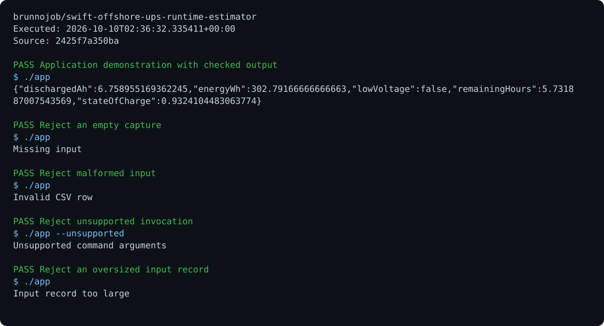

# swift-offshore-ups-runtime-estimator

Integrate UPS discharge histories with Peukert capacity correction and estimate remaining autonomy.

```sh
swiftc Sources/main.swift -o app
./app --self-test
./app < examples/input.txt
```

Offline diagnostic CLI built with Foundation. Sample records are synthetic; deployment needs measured data and installation-specific acceptance limits.

MIT. Built by [brunnodev](https://brunnodev.store).

## Execution proof

[](https://github.com/brunnojob/swift-offshore-ups-runtime-estimator/actions/workflows/proof.yml)



[Verified run](https://github.com/brunnojob/swift-offshore-ups-runtime-estimator/actions/runs/38017577821) · [Execution report](docs/proof/evidence.json)

Run `python .proof/record.py` after installing the prerequisites above. The scenarios execute repository code and verify exit codes and expected output. CI publishes `execution-proof` with the transcript, input fingerprints and source commit. The downloadable report identifies the exact tested version; the workflow badge tracks the latest run.
